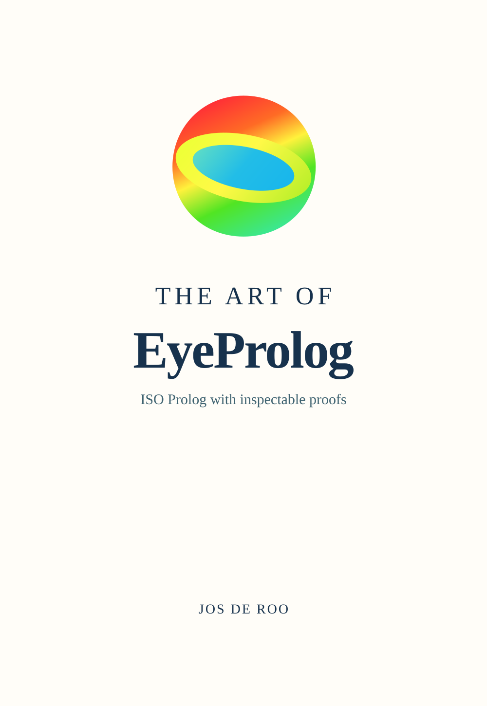

# EyeProlog

[](https://www.npmjs.com/package/eyeprolog)
[](https://doi.org/10.5281/zenodo.21446308)

EyeProlog is an ISO Prolog implementation for JavaScript that turns portable programs into answers and inspectable proofs.

<p>
  <a href="https://eyereasoner.github.io/eyeprolog/the-art-of-eyeprolog">
    
  </a><br>
  <strong>Click the cover to read <em>The Art of EyeProlog</em>.</strong>
</p>

The single implementation reference is [*The Art of EyeProlog*](https://eyereasoner.github.io/eyeprolog/the-art-of-eyeprolog).
It documents the language, built-ins, libraries, command line, JavaScript API,
examples, proofs, conformance profile, and implementation.

## Twenty years of EYE, and the next twenty years

The Euler project began in 2001 and became EYE, a Prolog-based reasoner, in 2006; it is still alive in 2026. In a symbolic way, EYE remembers Leonhard Euler, who lost sight in one eye. The Retina project began in 2021 and became EyeProlog in 2026; we hope to keep it growing for the next twenty years. That continuation offers a second quiet remembrance of Euler, who later lost sight in his other eye—while the project keeps trying to see farther through logic, proof, and reasoning.

## Quick start

EyeProlog requires Node.js 18 or newer:

```sh
node --version
```

If necessary, upgrade through a Node version manager or the
[official Node.js download](https://nodejs.org/en/download).

Run EyeProlog without installing it globally:

```sh
npx --yes eyeprolog
?- member(X, [prolog, logic]).
   X = prolog
;  X = logic.
?- halt.
```

For a persistent command, use a user-owned npm prefix:

```sh
npm install --global --prefix "$HOME/.local" eyeprolog
export PATH="$HOME/.local/bin:$PATH"
eyeprolog
```

Add the `PATH` export to your shell startup file. Do not use `sudo npm install`;
npm's [EACCES guidance](https://docs.npmjs.com/resolving-eacces-permissions-errors-when-installing-packages-globally/)
also recommends a Node version manager or a user-owned prefix.

Run a program non-interactively:

```sh
printf 'human(socrates).\nmortal(X) :- human(X).\n' |
  npx --yes eyeprolog --proof --goal 'mortal(socrates)' -
```

Or play the answer out as a dialogue, with the proof checker as the opponent:

```sh
printf 'human(socrates).\nmortal(X) :- human(X).\n' |
  npx --yes eyeprolog --dialogue --goal 'mortal(socrates)' -
```

## Links

- [The Art of EyeProlog](https://eyereasoner.github.io/eyeprolog/the-art-of-eyeprolog) — complete reference
- [Why EyeProlog?](https://eyereasoner.github.io/eyeprolog/why-eyeprolog) — project scope and design
- [ARC in EyeProlog](https://eyereasoner.github.io/eyeprolog/arc-in-eyeprolog) — answer, reason, check
- [SPEC.md](https://eyereasoner.github.io/eyeprolog/SPEC) — the answer, proof and check format, and the seven conditions C1–C7 a proof check establishes
- [Playground](https://eyereasoner.github.io/eyeprolog/playground) — run EyeProlog in a browser
- [Examples](examples) — runnable programs and checked output
- [Example decks](https://eyereasoner.github.io/eyeprolog/examples/deck/) — walkthroughs of Prolog programs, answers, and checked proofs
- [Introduction to EyeProlog](https://eyereasoner.github.io/eyeprolog/examples/deck/introduction-to-eyeprolog) — short presentation deck for first-time audiences
- [ISO conformance review](https://eyereasoner.github.io/eyeprolog/test/conformance/ISO-COMPLIANCE) — supported Part 1 profile
- [Latest Neumerkel conformity](https://eyereasoner.github.io/eyeprolog/test/conformance/NEUMERKEL-LATEST) — tracked result from the current live upstream inventory
- [Conformance report](https://eyereasoner.github.io/eyeprolog/conformance-report) — generated executable conformance status, local corpus summary, and known deviations
- [OpenRuleBench](https://eyereasoner.github.io/eyeprolog/openrulebench/) — portable benchmark profile

## Performance
EyeProlog does not carry a separate wall-clock benchmark harness. `npm test`'s own elapsed time, run across thousands of conformance, regression, and example programs, is the coarse performance indicator instead — a real slowdown shows up there. [OpenRuleBench](https://eyereasoner.github.io/eyeprolog/openrulebench/) remains a dedicated, checked correctness-and-scale benchmark for the Datalog rule-engine profile specifically.
For the project policy on post-ISO-standard and WG17 compatibility features such as digit separators, see [ISO/WG17 compatibility extensions](https://eyereasoner.github.io/eyeprolog/test/conformance/ISO-WG17-EXTENSIONS).
## Development
```sh
git clone https://github.com/eyereasoner/eyeprolog.git
cd eyeprolog
npm install
npm test
```
The npm command list is deliberately small:

- `npm test` (or `npm run test`): run all checks, including the eight Neumerkel conformity suites (WG17 syntax among them). Reuse `.cache/neumerkel/`, downloading the sources only when the cache is missing or incomplete.
- `npm run sync`: download the current upstream sources, check every discovered case and update the tracked Neumerkel report. This needs network access.
- `npm run neumerkel`: re-fetch the upstream Neumerkel conformity sources and fail if the tracked report no longer matches them. The release gate reports that drift as a warning; this command makes it an error, so it answers "are we still current?" on its own.

Once the cache exists, ordinary tests need no upstream access. `npm test -- --offline` skips the eight upstream suites entirely; `node test/run-neumerkel.mjs --cached` runs them without permitting downloads. Focused checks remain available directly, for example `node test/run-regression.mjs docs`; see [test runners](https://eyereasoner.github.io/eyeprolog/test/). The automatic version hooks rebuild generated library and book files, sync the current upstream suites once, run the release gate from that cache, stage conformance reports, and push the release. Detailed upstream report maintenance is documented in the [conformance guide](https://eyereasoner.github.io/eyeprolog/test/conformance/).

EyeProlog is released under the [MIT License](LICENSE.md).
